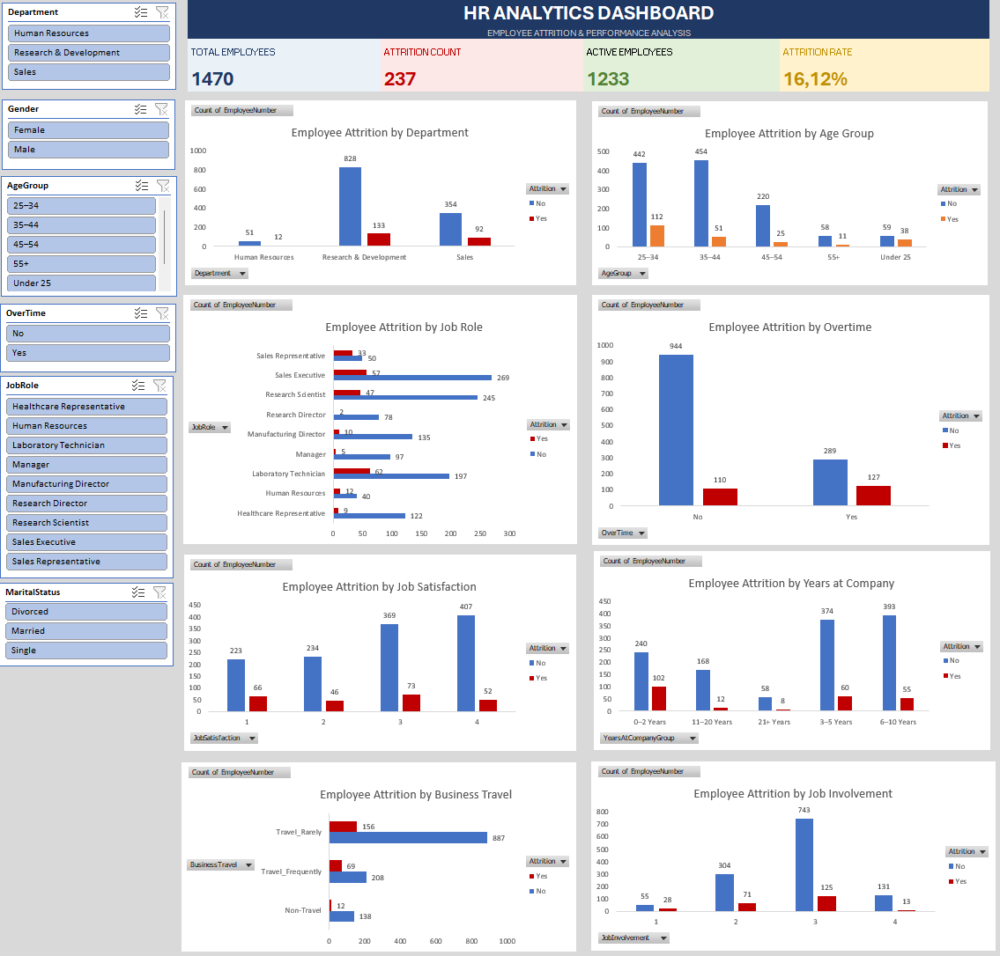

# IBM HR Analytics – Employee Attrition & Performance Analysis

An Excel-based HR analytics project focused on analyzing employee attrition patterns, workforce characteristics, and factors associated with employee turnover. This project uses Microsoft Excel to perform data preparation, data quality assessment, exploratory data analysis, Pivot Table analysis, and interactive dashboard development.

The analysis aims to provide insights into employee attrition across departments, age groups, job roles, overtime, job satisfaction, tenure, and other workforce characteristics to support data-driven Human Resources (HR) decision-making.

---

## Table of Contents

- [Project Overview](#project-overview)
- [Business Problem](#business-problem)
- [Project Objectives](#project-objectives)
- [Dataset Description](#dataset-description)
- [Tools & Technologies](#tools--technologies)
- [Project Workflow](#project-workflow)
- [Key Performance Indicators](#key-performance-indicators)
- [Key Business Insights](#key-business-insights)
- [Business Recommendations](#business-recommendations)
- [Repository Structure](#repository-structure)
- [How to Use](#how-to-use)
- [Project Limitations](#project-limitations)
- [Conclusion](#conclusion)

---

## Project Overview

Employee attrition is an important issue for organizations because employee turnover can affect workforce stability, recruitment costs, productivity, and organizational performance.

This project analyzes the IBM HR Analytics Employee Attrition & Performance dataset to identify employee groups with relatively high attrition rates and explore how attrition is distributed across different employee characteristics.

The entire analysis was performed using **Microsoft Excel**, without relying on Python, SQL, or Power BI.

The project includes an Interactive Pivot Dashboard – A dashboard built using Pivot Tables, Pivot Charts, and interactive Slicers that allow users to dynamically explore employee attrition.

---

## Business Problem

Organizations need to understand employee attrition patterns to develop effective workforce management and employee retention strategies.

However, identifying attrition patterns requires more than simply counting the number of employees who leave.

HR teams need to understand:

- Which departments have higher employee attrition rates?
- Which age groups are more likely to leave the organization?
- Which job roles experience relatively high attrition?
- Is overtime associated with higher employee attrition?
- How does job satisfaction relate to employee attrition?
- Does length of service show different attrition patterns?
- How do business travel frequency, job involvement, marital status, and stock option levels relate to attrition?

This project addresses these questions through structured HR data analysis and interactive Excel dashboards.

---

## Project Objectives

The main objectives of this project are:

1. Understand the structure and characteristics of the IBM HR Analytics dataset.
2. Assess data quality, validity, and consistency.
3. Prepare a structured dataset for analysis.
4. Calculate key HR performance indicators.
5. Analyze employee attrition across multiple workforce dimensions.
6. Identify employee groups with relatively high attrition rates.
7. Develop interactive Excel dashboards for HR data exploration.
8. Provide actionable business insights and recommendations based on analytical findings.

---

## Dataset Description

**Dataset:** IBM HR Analytics Employee Attrition & Performance

**Original File:** `WA_Fn-UseC_-HR-Employee-Attrition.csv`

**Dataset Size:**

| Attribute | Value |
|---|---:|
| Total Records | 1,470 |
| Original Columns | 35 |
| Missing Values | 0 |
| Duplicate Records | 0 |
| Total Employees | 1,470 |

The dataset contains employee-related information, including demographic characteristics, job information, compensation, satisfaction, and attrition status.

### Main Dataset Categories

| Category | Example Attributes |
|---|---|
| Employee Demographics | Age, Gender, MaritalStatus |
| Job Information | Department, JobRole, JobLevel |
| Compensation | MonthlyIncome, DailyRate, HourlyRate |
| Work Experience | TotalWorkingYears, YearsAtCompany, YearsInCurrentRole |
| Employee Satisfaction | JobSatisfaction, EnvironmentSatisfaction |
| Work Conditions | OverTime, BusinessTravel, WorkLifeBalance |
| Employee Attrition | Attrition |

### Additional Derived Columns

Two additional analytical columns were created to support grouped analysis:

- **Age Group**
  - Under 25
  - 25–34
  - 35–44
  - 45–54
  - 55+

- **Years at Company Group**
  - 0–2 Years
  - 3–5 Years
  - 6–10 Years
  - 11–20 Years
  - 21+ Years

---

## Tools & Technologies

| Tool | Purpose |
|---|---|
| Microsoft Excel | Data preparation, analysis, calculations, and dashboard development |
| Excel Tables | Structured dataset management |
| Excel Formulas | KPI calculations and derived columns |
| Pivot Tables | Aggregated HR analysis |
| Pivot Charts | Data visualization |
| Slicers | Interactive dashboard filtering |

### Excel Features Used

- Excel Tables
- IF
- COUNTIF / COUNTIFS
- AVERAGE / AVERAGEIF
- GETPIVOTDATA
- Pivot Tables
- Pivot Charts
- Slicers
- Conditional Formatting
- Dashboard Layout and Formatting

---

## Project Workflow

The project follows a structured data analytics workflow.

### 1. Data Understanding

- Imported the original IBM HR Analytics dataset.
- Reviewed dataset dimensions and column structures.
- Identified data types and variable categories.
- Created a Data Dictionary to document dataset attributes.

### 2. Data Quality Assessment

Performed data quality checks to evaluate the reliability of the dataset.

| Data Quality Check | Result |
|---|---:|
| Total Records | 1,470 |
| Missing Values | 0 |
| Duplicate Records | 0 |
| Data Type Mismatches | 0 |
| Invalid Values | 0 |
| Logical Consistency Issues | 0 |

### 3. Data Cleaning & Preparation

- Reviewed the original dataset.
- Checked missing and duplicate records.
- Validated data types.
- Checked the validity of categorical and numerical values.
- Evaluated logical consistency between related fields.
- Created derived columns for age and company tenure grouping.
- Prepared the final structured dataset in an Excel Table named `tbl_HR_Analytics`.

### 4. Exploratory Data Analysis (EDA)

Performed descriptive analysis to understand employee characteristics and attrition distribution.

The analysis covered:

- Employee demographics
- Department
- Job role
- Age group
- Overtime
- Job satisfaction
- Years at company
- Business travel
- Job involvement
- Marital status
- Stock option level

### 5. Pivot Table & Pivot Chart Analysis

Created 10 Pivot Tables and 10 Pivot Charts to analyze attrition across different workforce dimensions.

### 6. Dashboard Development

Developed two Excel dashboards to present key metrics and analytical findings.

---

## Key Performance Indicators

The following KPIs summarize the overall employee attrition situation.

| KPI | Result |
|---|---:|
| Total Employees | 1,470 |
| Attrition Count | 237 |
| Active Employees | 1,233 |
| Attrition Rate | 16.12% |
| Average Age | 36.92 |
| Average Monthly Income | 6,502.93 |

**Attrition Rate Calculation:**

Attrition Rate = (Employees with Attrition = Yes / Total Employees) × 100

= (237 / 1,470) × 100

= **16.12%**

---

## Key Business Insights

The analysis identified several important patterns in employee attrition.

### 1. Attrition by Department

| Department | Employees | Attrition | Attrition Rate |
|---|---:|---:|---:|
| Sales | 446 | 92 | 20.63% |
| Research & Development | 961 | 133 | 13.84% |
| Human Resources | 63 | 12 | 19.05% |

**Insight:**

The Sales department has the highest attrition rate at 20.63%, followed by Human Resources at 19.05%. Research & Development has a lower attrition rate of 13.84%.

### 2. Attrition by Age Group

| Age Group | Employees | Attrition | Attrition Rate |
|---|---:|---:|---:|
| Under 25 | 97 | 38 | 39.18% |
| 25–34 | 554 | 112 | 20.22% |
| 35–44 | 505 | 51 | 10.10% |
| 45–54 | 245 | 25 | 10.20% |
| 55+ | 69 | 11 | 15.94% |

**Insight:**

Employees under 25 have the highest attrition rate at 39.18%. The 25–34 age group also shows a relatively high attrition rate of 20.22%.

This suggests that younger employees may require greater attention regarding onboarding, career development, and employee retention.

### 3. Attrition by Job Role

| Job Role | Employees | Attrition | Attrition Rate |
|---|---:|---:|---:|
| Sales Representative | 83 | 33 | 39.76% |
| Laboratory Technician | 259 | 62 | 23.94% |
| Human Resources | 52 | 12 | 23.08% |
| Sales Executive | 326 | 57 | 17.48% |
| Research Scientist | 292 | 47 | 16.10% |
| Manufacturing Director | 145 | 10 | 6.90% |
| Healthcare Representative | 131 | 9 | 6.87% |
| Manager | 102 | 5 | 4.90% |
| Research Director | 80 | 2 | 2.50% |

**Insight:**

Sales Representatives have the highest attrition rate at 39.76%, followed by Laboratory Technicians at 23.94%.

These job roles may require further investigation into workload, career progression, compensation, and employee experience.

### 4. Attrition by Overtime

| Overtime | Employees | Attrition | Attrition Rate |
|---|---:|---:|---:|
| Yes | 416 | 127 | 30.53% |
| No | 1,054 | 110 | 10.44% |

**Insight:**

Employees who work overtime have a substantially higher attrition rate than employees who do not work overtime.

The difference is approximately 20.09 percentage points, indicating that overtime status is an important dimension to investigate in employee retention analysis.

### 5. Attrition by Job Satisfaction

| Job Satisfaction | Employees | Attrition | Attrition Rate |
|---|---:|---:|---:|
| 1 - Low | 289 | 66 | 22.84% |
| 2 - Medium | 280 | 46 | 16.43% |
| 3 - High | 442 | 73 | 16.52% |
| 4 - Very High | 459 | 52 | 11.33% |

**Insight:**

Employees with low job satisfaction have the highest attrition rate at 22.84%.

Employees with very high job satisfaction have the lowest attrition rate at 11.33%.

This indicates an association between job satisfaction levels and employee attrition.

### 6. Attrition by Years at Company

| Years at Company | Employees | Attrition | Attrition Rate |
|---|---:|---:|---:|
| 0–2 Years | 342 | 102 | 29.82% |
| 3–5 Years | 434 | 60 | 13.82% |
| 6–10 Years | 448 | 55 | 12.28% |
| 11–20 Years | 180 | 12 | 6.67% |
| 21+ Years | 66 | 8 | 12.12% |

**Insight:**

Employees with 0–2 years of service have the highest attrition rate at 29.82%.

This highlights the importance of early employee experience, onboarding, and retention initiatives during the first years of employment.

### 7. Attrition by Business Travel

| Business Travel | Employees | Attrition | Attrition Rate |
|---|---:|---:|---:|
| Non-Travel | 150 | 12 | 8.00% |
| Travel Frequently | 277 | 69 | 24.91% |
| Travel Rarely | 1,043 | 156 | 14.96% |

**Insight:**

Employees who travel frequently have the highest attrition rate at 24.91%.

This suggests that frequent business travel may be an important factor to investigate when evaluating employee experience and work-life balance.

### 8. Attrition by Job Involvement

| Job Involvement | Employees | Attrition | Attrition Rate |
|---|---:|---:|---:|
| 1 - Low | 83 | 28 | 33.73% |
| 2 - Medium | 375 | 71 | 18.93% |
| 3 - High | 868 | 125 | 14.40% |
| 4 - Very High | 144 | 13 | 9.03% |

**Insight:**

Employees with low job involvement have the highest attrition rate at 33.73%, while employees with very high job involvement have the lowest rate at 9.03%.

This highlights the relevance of employee engagement and involvement in workforce retention analysis.

### Additional Supporting Analysis

The project also examines attrition by marital status and stock option level.

| Marital Status | Employees | Attrition | Attrition Rate |
|---|---:|---:|---:|
| Single | 470 | 120 | 25.53% |
| Married | 673 | 84 | 12.48% |
| Divorced | 327 | 33 | 10.09% |

| Stock Option Level | Employees | Attrition | Attrition Rate |
|---|---:|---:|---:|
| Level 0 | 631 | 154 | 24.41% |
| Level 1 | 596 | 56 | 9.40% |
| Level 2 | 158 | 12 | 7.59% |
| Level 3 | 85 | 15 | 17.65% |

**Insight:**

Single employees have a higher attrition rate than married and divorced employees. Employees with Stock Option Level 0 also show a relatively high attrition rate.

These patterns can help HR teams identify areas for further investigation.

---


## Interactive Pivot Dashboard

An interactive dashboard developed using Pivot Tables, Pivot Charts, and Slicers.

**Key Components:**

- 4 KPI Cards
- 8 Pivot Charts
- 6 Interactive Slicers

**Interactive Filters:**

1. Department
2. Gender
3. Age Group
4. OverTime
5. Job Role
6. Marital Status

**Dashboard Preview:**



The Slicers allow users to filter employee data dynamically and observe changes in KPI values and charts.

---

## Business Recommendations

Based on the analytical findings, the following recommendations are proposed.

### 1. Strengthen Employee Retention in High-Attrition Departments

Focus on the Sales and Human Resources departments, which show relatively high attrition rates.

Recommended actions:

- Conduct employee satisfaction surveys.
- Evaluate workload distribution.
- Review compensation and career development opportunities.
- Conduct regular employee feedback sessions.

### 2. Improve Retention Among Younger Employees

Employees under 25 have the highest attrition rate.

Recommended actions:

- Strengthen onboarding and mentoring programs.
- Provide structured career development paths.
- Offer training and professional development opportunities.
- Conduct regular check-ins with new employees.

### 3. Review Workload and Overtime Practices

Employees who work overtime show a considerably higher attrition rate.

Recommended actions:

- Monitor overtime frequency and duration.
- Evaluate workload distribution across teams.
- Encourage appropriate work-life balance.
- Review staffing requirements in departments with frequent overtime.

### 4. Investigate High-Attrition Job Roles

Sales Representatives and Laboratory Technicians show relatively high attrition rates.

Recommended actions:

- Conduct role-specific employee feedback sessions.
- Evaluate job responsibilities and workload.
- Review compensation and performance expectations.
- Identify possible career progression barriers.

### 5. Improve Early Employee Retention

Employees with 0–2 years of service have a relatively high attrition rate.

Recommended actions:

- Develop a structured onboarding program.
- Assign mentors to new employees.
- Conduct regular probation and early-tenure evaluations.
- Identify challenges experienced by new employees.

### 6. Strengthen Employee Engagement and Satisfaction

Lower job satisfaction and job involvement levels are associated with higher attrition rates.

Recommended actions:

- Conduct regular employee engagement surveys.
- Improve communication between managers and employees.
- Provide recognition and development opportunities.
- Encourage employee participation in workplace decisions.

### 7. Evaluate Business Travel Requirements

Employees who travel frequently show a relatively high attrition rate.

Recommended actions:

- Review frequent travel assignments.
- Evaluate the impact of travel on employee well-being.
- Consider flexible scheduling where operationally possible.
- Gather feedback from employees with frequent travel responsibilities.

---

## Repository Structure

The following structure is recommended for organizing the project files:

```text
IBM-HR-Analytics-Employee-Attrition/
│
├── dashboard/
│   └── pivot_dashboard.png
│    
├── data/
│   ├── WA_Fn-UseC_-HR-Employee-Attrition.csv
|
├── documentation/
│   ├── Business_Insights.md
│   └── Business_Recommendations.md
│
├── workbook/
│   └── IBM_HR_Analytics_Employee_Attrition.xlsx
│
└── README.md
```

---

## How to Use

1. Clone or download this repository.
2. Open the `workbook` folder.
3. Open `IBM_HR_Analytics_Employee_Attrition.xlsx` using Microsoft Excel.
4. Navigate to the `Pivot_Dashboard` sheet to explore the interactive dashboard.
5. Use the available Slicers to filter employee data by department, gender, age group, overtime, job role, and marital status.
6. Clear the Slicer filters to return to the overall employee analysis.

**Note:** Microsoft Excel desktop is recommended for the best experience with Pivot Tables, Pivot Charts, and Slicers.

---

## Project Limitations

- The analysis is based on a single IBM HR Analytics dataset containing 1,470 employee records.
- The dataset represents a specific workforce snapshot and does not provide a complete longitudinal view of employee turnover.
- The analysis identifies associations and patterns, not causal relationships.
- The findings should not be interpreted as proof that a particular employee characteristic causes attrition.
- Business recommendations require further validation using additional HR information and organizational context.

---

## Conclusion

This project demonstrates how Microsoft Excel can be used to perform a complete HR analytics workflow, from data understanding and quality assessment to exploratory analysis, Pivot Table analysis, and interactive dashboard development.

The analysis identifies several employee groups with relatively high attrition rates, particularly employees under 25, Sales Representatives, employees working overtime, and employees with 0–2 years of service.

The two dashboards provide both an overall view and an interactive way to explore workforce patterns.

The resulting insights and recommendations can support HR teams in identifying potential retention challenges and developing more informed employee management strategies.

---


